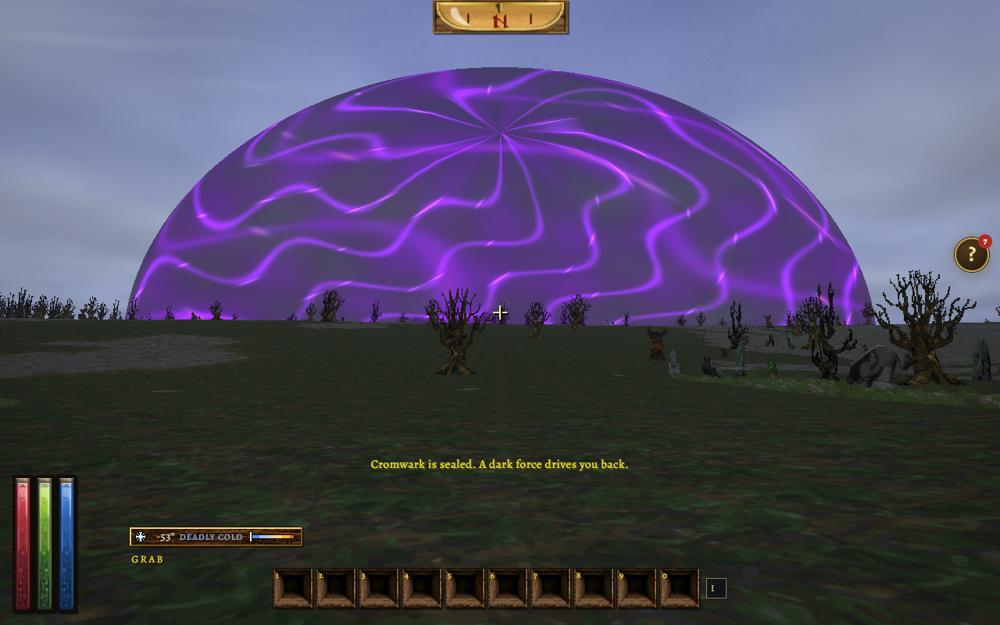
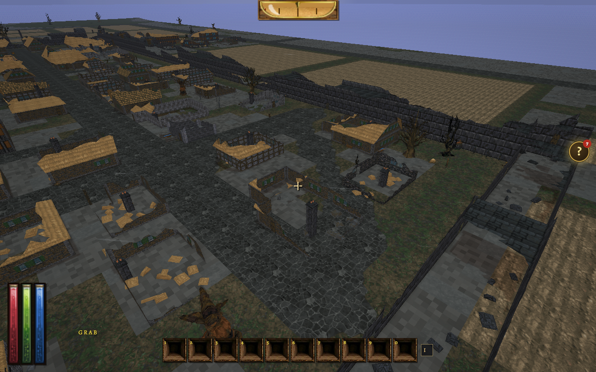

# Cromwark encounters — first combat pass

The seven supplied monsters lead Cromwark's exterior encounters. Normal encounter-table enemies, their elites, Unquiets and returning revenants remain supporting threats. This pass changes combat first; settlement destruction and the campaign's final boss are separate work.

## Encounter mix

Seeded encounter grants select the new cast on 60% of rolls and retain the existing table on 40%. Ring I introduces Judge, Horror Mite, Crystal Hulk and Frozen; ring II adds Gazadar and Bishop; rings III–IV add Pain. The grant's pixel, seed and member index determine the same result on every client. Camps, quest foes, summons, placed enemies and revenant spawners keep their own selections.

The exterior encounter cap is eight. A nearby cast budget of four pressure points allows at most three active custom attacks: Judge/Gazadar/Bishop cost two, Pain three, Mite/Hulk/Frozen one. Observed remote casts also consume that budget. This is a local coordination limit, not a global server reservation; simultaneous decisions by different owners can temporarily overlap.

## Cast

| Enemy | Attack and counterplay |
| --- | --- |
| Judge | Three evenly spaced volleys of slow orbs. Move between pellets; the next wave rotates half a gap. A small initial disc prevents standing inside the caster. |
| Horror Mite | Three quick, separately warned straight charges. Every third attack uses two expanding spin rings instead. Step sideways or cross into the safe inner ring. |
| Gazadar | A locked, 25m piercing lane with a 1.25s warning. Every player in the lane judges the hit, including players it was not targeting. Elites follow with two angled lanes. |
| Crystal Hulk | A 1.4s warned slam with substantial knockback, followed periodically by an outer shock ring. Its larger body and health distinguish it from casters. |
| Bishop | Bombards the target's locked position, then the surrounding ground in staggered circles. Leave the first circle and use the gaps between the next ones. |
| Pain | A delayed inner ring, four separated spokes, then an outer ring and central disc. Its slow movement leaves recovery opportunities. Elites add a final set of spaced circles. |
| Frozen | Warned blasts at the target's locked position. A hit slows movement to 60% for four seconds; refreshes duration without stacking movement penalties. |

Warnings use the existing ground-telegraph renderer. The same dimensions drive collisions. Lasers and projectiles stop at solid geometry; ground attacks also require line of sight to the affected player. Death, paralysis, yielding and stagger cancel the cast. Mite charges use the normal collision capsule. Unavailable orb art cannot deal invisible damage.

Normal health ranges from 85 to 260. Custom elites have 1.6× health, keep elite loot/identity and use denser patterns or faster recovery instead of the generic elite trait overlay. Hits cost 4.5–20% of maximum player health, capped at 32 damage, through the host's existing hurt callback. These are explicit pattern damage values rather than ordinary weapon accuracy/armour rolls. One cast cannot hit a player more often than every 0.4s. This initial balance needs live group playtesting.

## Multiplayer and lifecycle

Custom IDs 3136–3142 use their own controller. Existing foe records carry the attack serial (`wn`), locked origin (`wo`), yaw (`wy`), elapsed pattern seconds (`wp`), and aim distance in 2m steps in `wk`'s upper four bits. The lower three bits are zero. `wl` remains a bounded wind-up value. Standard foes retain their original decoding.

Every client resolves its own player's capsule against the shared pattern, so piercing attacks do not depend on the selected recipient. Owner hit budgets and streamed health bounds still apply. Duplicate records do not restart a cast. New readers receive 0.35s grace and cannot replay past landings. Locked origins rebase with the world; removed or dead foes discard their hazards. A monotonic clock keeps attack rhythm independent of rendering rate, pauses with the foes, and suppresses catch-up damage on long frame stalls.

The sprites are the user's original transparent PNGs, reused for every facing and pose. They are single-frame artwork, not fabricated animation sheets. Archive IDs are 9940–9946; 9947 holds the procedural Judge orb.

## Retired zone mechanics

Cromwark no longer multiplies all enemy health/damage by the old 5–8× zone/ring factors. The escalating haze counter, generic purple enemy tint and eight Greater Giant encounters are disabled. Geography, peaceful shared PvE, Dusk drops, camp rewards and blight campaign persistence remain. Haze-Walker Boots now halve Frozen slow duration, including already-owned boots identified by their power kind. Retired haze-duration title triggers no longer progress. The Eltheric Ocean retains its separate PvP, scaling and encounter cap.

## Settlement density revision

The owner requested roughly one third of the previous settlement density without shrinking the area. Classic map tables contain 304 civilian sites inside the Cromwark polygon; the previous name-based audit missed ten rows with duplicate names. The revision retains 101 civilian sites and removes 203 from active geography. The 178 dungeon/graveyard sites remain, along with Cromwark Hamlet and the full zone boundary.

| Kind | Before | Retained |
| --- | ---: | ---: |
| Cities | 9 | 3 |
| Hamlets | 20 | 7 |
| Villages | 22 | 7 |
| Farms | 75 | 25 |
| Temples | 56 | 19 |
| Inns | 43 | 14 |
| Wealthy homes | 15 | 5 |
| Cult sites | 15 | 5 |
| Small homes | 49 | 16 |

Farthest-point selection distributes each retained type across the region, with Cromwark Hamlet protected. The resulting manifest is fixed by map ID, so clients share one layout. Removed sites load as wilderness; this pass does not add rubble at their former coordinates. Retained settlements still use the existing desolation rules.

`cromwarkSettlements.js` filters the map directory, name/ID lookups and location loading. Travel searches, new quest-site selection, directions, map-item discovery, scrying, road destinations, respawn choices and Legacy birth destinations exclude retired sites. Roads rebuild between surviving destinations. Raw archive row indices remain stable, and retained duplicate names resolve to a retained row. No ARENA2 files, saved ownership records or active quest records are deleted or rewritten. Existing property/quest records referencing a retired site will require a rollout migration decision; preserving their IDs keeps that possible.

Reproduce the manifest with `node tools/cromwarkSettlementPlan.mjs --arena2 <ARENA2> --write`. Run its integration checks with `ARENA2_PATH` pointing at the local game data and `node --test tools/cromwarkSettlements.test.mjs`. The real-data check verifies every retained location across the world, not only Cromwark, and confirms removed sites stay absent after region cache eviction.

## Environmental destruction pass

Cromwark's retained settlements now build damaged exterior geometry: roofless shells, breached walls and collapsed buildings with fallen roof fragments. A stable hash of location ID, block coordinates and building record chooses each treatment. Damage becomes more prevalent toward the heart. Fracture edges alone receive bounded subdivision so low-polygon classic walls break irregularly rather than appearing neatly sliced. Original Daggerfall texture references and interpolated UVs remain; debris prefers roof materials rather than wall textures with painted windows.

The source ARCH3D meshes are never changed. Each damaged instance goes into the pixel's ordinary static batch, and the exact same positions/indices go into collision. Exposed wall interiors are visible. Door panels and nearby standing sections remain, dungeon entrances and city-gate machinery are protected, and original building/quest addresses stay stable. Damaged properties do not repeatedly rebuild to apply a house paint preview; persistent ownership itself is not altered.

The ground-cover field leaves increasingly sparse surviving pockets, with continuous coordinates across pixel borders. Dead-tree selection now uses only the genuinely bare records in TEXTURE.508: 16, 18, 24, 25 and 30. The previous list included two healthy canopies. Settlement trees, scaled scenery, ordinary wilderness trees and optional jungle/roadside trees all receive the treatment. Converted block trees stay dead through seasonal re-skinning. Terrain LOD rebuilds preserve the scorch setting.

Desolate settlements no longer draw static livestock, static crop scenery, ordinary lit street lamps or festival dressing. Enhanced mills keep their bodies but no moving sails. Player-managed farming is separate from this static scenery pass. Ambient crowds, smithies, taverns and healthy wildlife calls fall silent, and optional butterflies/fireflies/petals are suppressed. Weather, wind and combat audio remain. This pass changes physical ruins and ecology; bespoke narrative landmarks, investigation rewards and a final city encounter are later work.

`tools/cromwarkRuins.test.mjs` checks deterministic placement, source preservation, texture/door preservation, real collision through a removed roof, protected entrances, vegetation seams, ambience and the actual Cromwark Hamlet ARCH3D/RMB models. It shares the `ARENA2_PATH` integration-test convention. The shot-only `__cromwarkEnvironment()` probe reports loaded damage counts and ruined building bounds for real-engine screenshots.

## Validation commands

Run `node --test tools/cromwarkCombat.test.mjs`, lint the changed files and build the client. The shot-only `window.__cromwark()` probe exposes the real exterior pool for local visual checks. Visual fixtures should be identified as staged encounters, not natural multiplayer sessions. Live relay playtesting remains necessary before treating group balance as final.

## City seal and reach encounters

Cromwark Hamlet is sealed by a 380m high purple dome with animated dark clouds and luminous swirling veins. Its radius comes from the actual classic city layout (about 500m), enclosing every block corner. The horizontal exclusion guard applies at every player altitude, checks swept movement, and restores the last safe nearby footstep when someone crosses it. Teleports and characters restored in the city, including its interiors and dungeons, are relocated through the ordinary streamed, grounded arrival to pixel 823,36 south of the city. A shot-mode free camera remains available for inspection. The seal is independent of Rodney's expanding blight: daily expansion, pushback, territorial holds and ring-based Nyx Dusk Token kill rolls remain. Reach rituals do not open the city.

Optional reach events use deterministic daily destinations, one per 3x3 map-pixel sector. Settlements, water and the city seal's neighbouring pixels are excluded. A nearby world beacon and an approach notice identify the objective. Three foes form each encounter, using existing WOD site ownership/race arbitration, foe grants, combat and corpse loot:

- **Shard Hunt:** Horror Mite, Crystal Hulk and a skeletal warrior patrol a 35m trail with the collision-aware motor. They can be pursued or avoided.
- **Hollow Choir:** Bishop and Pain conduct the ritual with a zombie supporting them. Removing either caster removes its contribution to the overlapping, telegraphed patterns. This first ritual objective is to defeat the group; it has no extra invisible damage pulse.
- **Forsaken Supplies:** Gazadar, Frozen and an orc guard a supply cache. Observing all three guards' corpses unlocks one ordinary loot-table cache per character, per site, per day. Unclaimed contents and observed kills ride mod save data, so reopening does not reroll rewards. Caches do not mint premium currency or guaranteed Dusk Tokens.

Only a nearby encounter spawns. Missing foes do not count as kills; failed slots retry without copying survivors. A live peer suppresses local copies; a stale owner may be replaced after ten seconds using observed survivor memory. Pending spawns cancel on reset. Floating-origin positions are recomputed from map coordinates. Events remain during a fight across midnight and otherwise rotate when left. Bounded character memory retains the previous day's active event. Like existing WOD sites, this has no server-persistent global encounter completion ledger: a player who did not observe the kills may later meet guards again. Cooperative relay playtesting and economy tuning remain necessary.

The reach suite checks actual city geometry and the safe fallback, swept/vertical exclusion, daily determinism, shared-site validation, cache save/reload, failed-slot retry, orphan ownership, pending-spawn cancellation, patrol wiring and midnight progress. Run all focused tests with ARENA2_PATH set:

`node --test tools/cromwarkCombat.test.mjs tools/cromwarkSettlements.test.mjs tools/cromwarkRuins.test.mjs tools/cromwarkReach.test.mjs`

## In-engine previews

Captured locally with the owner's ARENA2 files. The forcefield view follows a staged entry into the sealed volume and confirms the ordinary player is relocated onto solid ground at pixel 823,36. The ruins view uses the shot-mode free camera. These are rendering/relocation checks, not live multiplayer balance tests.

Real-engine smoke test (Chrome, Playwright and the local licensed game files):

`node tools/cromwarkWorldProbe.mjs --output <absolute-preview.png>`

Set ARENA2_PATH first. It starts and closes an ephemeral Vite server and headless browser, stages a player inside the seal, and asserts relocation outside the volume, contact with actual terrain, stable dome height after streaming/rebasing, and no page exceptions.

New random quest-site selection and Legacy birth-town selection also exclude the sealed city, while it remains visible and renderable. Existing authored or saved quest/property references are preserved and remain a rollout review item.
